<p align="center">
  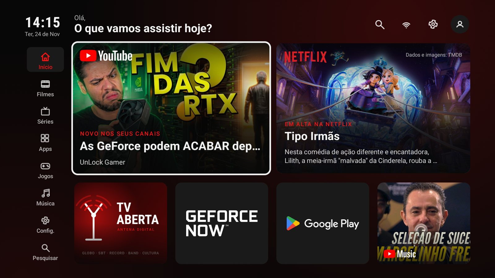
</p>

<h1 align="center">Lume TV</h1>

<p align="center">
  <b>Uma tela inicial própria para Google TV: leve, rápida e pensada para o controle remoto.</b><br>
  Feita e testada numa TV <b>TCL P7 de 50"</b> (Google TV · Android 12 · 2 GB de RAM).
</p>

<p align="center">
  <a href="https://github.com/rodneigstv/nova-tv/releases/latest"></a>
  
  
  
  
  <a href="LICENSE"></a>
</p>

<p align="center">
  <a href="https://github.com/rodneigstv/nova-tv/releases/latest"><b>Baixar o APK</b></a> ·
  <a href="#instalação">Instalação</a> ·
  <a href="#desempenho">Desempenho</a> ·
  <a href="#fases-do-projeto">Fases do projeto</a> ·
  <a href="#compilar-com-as-suas-chaves">Compilar</a>
</p>

> [!IMPORTANT]
> O Lume TV foi feito para **uma TV específica: TCL P7 de 50" com Google TV (Android 12)**. Pode funcionar em outras TVs com Android TV 9 ou mais novo, mas só foi testado nessa. Os botões Netflix, YouTube, engrenagem e TV usam códigos próprios do controle da TCL.

## Sobre

O Lume TV troca a tela inicial do Google TV por uma interface própria: vermelho vivo sobre preto, só com o que se usa em casa (YouTube, Netflix, TV aberta, GeForce NOW, Google Play e YouTube Music), sem propaganda, sem rastreamento e sem servidor próprio. O app conversa direto com as APIs oficiais.

Todo o app foi escrito em **Kotlin com as Views do próprio Android, desenhadas no `Canvas`, sem nenhuma biblioteca externa**. O APK tem cerca de 340 KB.

O projeto começou com o nome **Nova TV**, por isso o repositório se chama `nova-tv` e o pacote Android continua `com.exemplo.novatv` (trocar o pacote apagaria os dados e as configurações já feitas na TV).

## Funcionalidades

- **Dois destaques que trocam de título sozinhos a cada 9 s**
  - **YouTube**: vídeos que você curtiu e os mais novos dos seus canais (YouTube Data API v3, login de TV com código).
  - **Netflix**: filmes e séries em alta no Brasil (dados do TMDB).
- **Quatro cards** que alternam entre logo e imagem a cada 3,5 s: **TV Aberta** (abre direto a antena digital), **GeForce NOW** (capturas oficiais dos jogos na loja Steam), **Google Play** e **YouTube Music** (músicas curtidas).
- **Menu lateral dinâmico**: parar o foco num item por 0,2 s já abre a página, sem apertar OK.
- **Filmes e Séries só com o que está na Netflix no Brasil**, em fileiras que rolam para o lado: em alta, recomendados pelo histórico de visualização exportado da Netflix, "Porque você assistiu…", mais bem avaliados, lançamentos e gêneros.
- **Apps, Jogos e Música**: todos os apps instalados, separados por tipo, com logos nítidos.
- **Monitor do sistema**: CPU, RAM, armazenamento, estado térmico, núcleos, FPS da interface, rede e sistema. Abre com a seta para a direita no último card ou no destaque da Netflix.
- **Botões do controle**: Netflix, YouTube, engrenagem e TV funcionam em qualquer tela, por um serviço de acessibilidade (eles paravam de funcionar quando a tela do Google TV era desativada).
- **Apps sempre na página inicial**: cards, destaques e botões abrem cada app do começo, não onde ele tinha parado.
- **Feito para o controle remoto**: foco bem visível, área segura de 5% nas bordas, textos legíveis a 3 m e animações de no máximo 300 ms.

## Telas

| Filmes (só Netflix) | Séries |
|---|---|
| 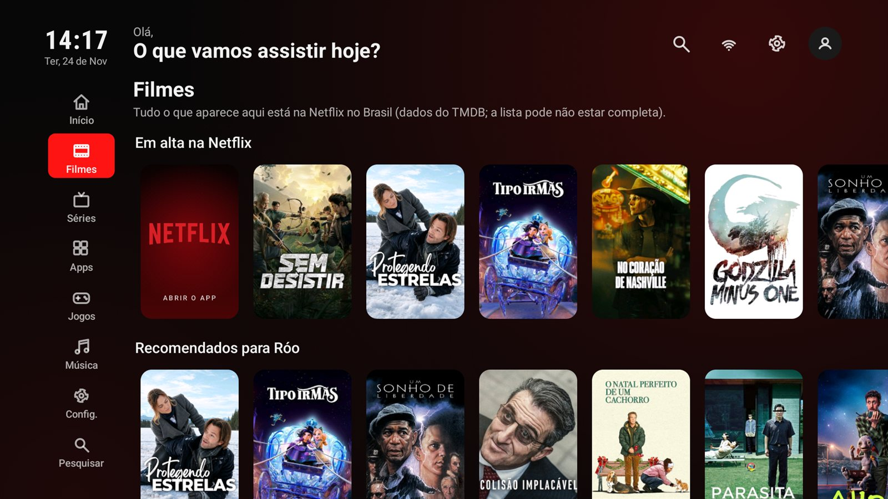 | 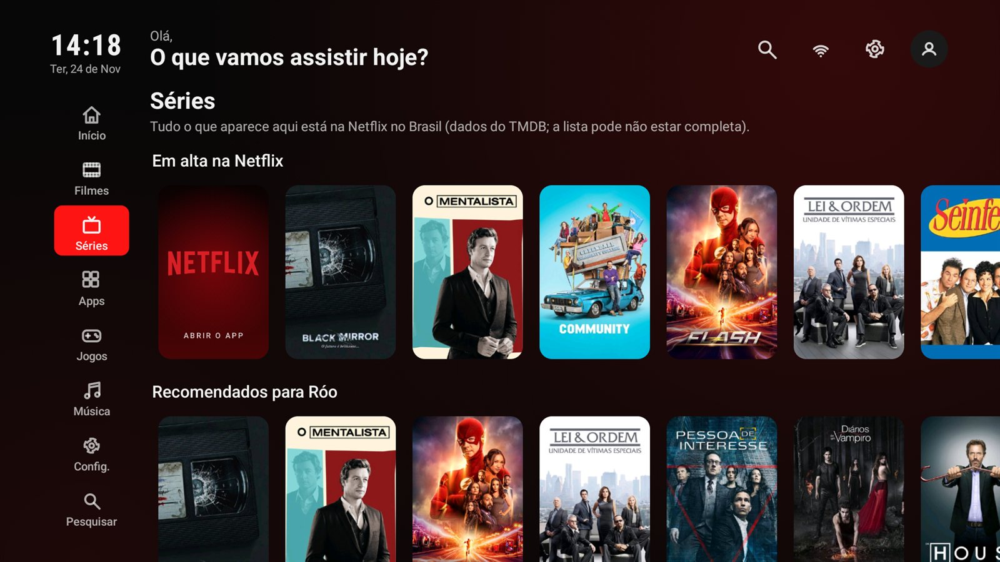 |
| **Apps** | **Monitor do sistema** |
| 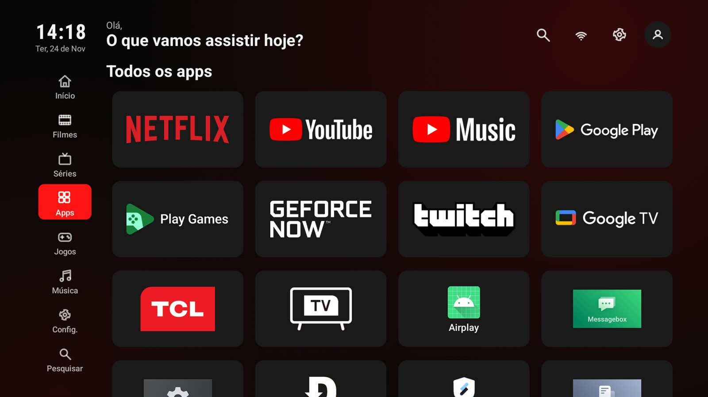 | 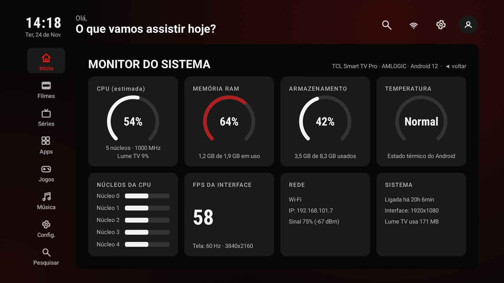 |
| **Foco nos cards** | **Perfil** |
| 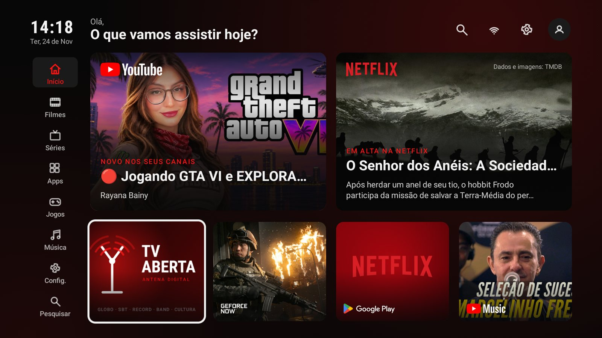 | 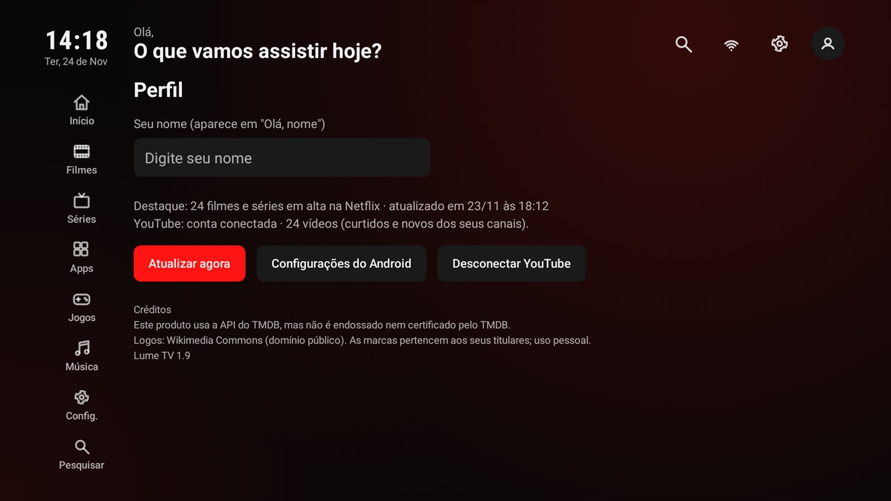 |

<sub>Prints tirados na própria TV pelo ADB (1920×1080). Pôsteres e miniaturas: TMDB, YouTube e Steam; as marcas pertencem aos seus titulares.</sub>

## Desempenho

Medido na própria TV, sempre com o mesmo roteiro de navegação pelo ADB: `dumpsys gfxinfo` (tempo de quadro), `top` (CPU do app) e `dumpsys meminfo` (memória). A versão 1.8 foi uma rodada só de visual e desempenho, sem mudar nenhuma função; a comparação é com a 1.7.

| Medida | 1.7 (antes) | 1.8 (depois) | Diferença |
|---|---:|---:|---:|
| CPU do app com o Início parado | 24,3% | **11,6%** | **−52%** |
| Quadros atrasados navegando no Início | 3,7% | **2,2%** | **−41%** |
| Tempo de quadro (p90) com o Início parado | 16 ms | **12 ms** | −25% |
| Tempo de quadro (p90) navegando no Início | 36 ms | **32 ms** | −11% |
| Tamanho do APK | 360,8 KB | **349,8 KB** | −3% |

Na versão atual (1.9):

- **Volta de um app para o Início: 72 ms** (mediana de 5 medições com `am start -W`).
- **Abertura com o app fechado: ~0,39 s** (medido na 1.0).
- Memória: de 204 a 225 MB (PSS), praticamente igual à 1.7; varia com o cache de texturas.
- Nas páginas Apps e Filmes a navegação continuou fluida (p90 de 12 ms e 17 ms, com um quadro atrasado em cada roteiro).

### O que deixou o app mais leve

- **Fundo pré-renderizado**: o brilho vermelho era redesenhado com gradientes de tela cheia a cada quadro. Virou uma imagem em meia resolução, desenhada uma vez fora da linha principal e só deslocada pela placa de vídeo.
- **Sem sombras nem desfoques** (`setShadowLayer`, `BlurMaskFilter`): o foco virou um anel sólido com leve aumento.
- **Animações só de escala, opacidade e deslocamento**, de até 300 ms.
- **Views criadas só quando usadas**: a vitrine automática, desligada, nem é montada.
- **Rolagem recortada** com `clipBounds`, sem desenhar por baixo do cabeçalho e do menu.
- **R8** (minify e shrink) e **nenhuma biblioteca externa**.

## Instalação

> [!WARNING]
> Trocar a tela inicial mexe em apps do sistema. Nada é desinstalado e não precisa de root, mas faça com calma e guarde o [caminho de volta](docs/RECUPERACAO.md).

**Você vai precisar de:** a TV e um computador na mesma rede, com o [ADB](https://developer.android.com/tools/releases/platform-tools) instalado (Platform Tools, do Google).

1. **Baixe o APK** na [página da versão mais recente](https://github.com/rodneigstv/nova-tv/releases/latest).
2. **Ative o modo desenvolvedor na TV**: Configurações → Sistema → Sobre → aperte OK 7 vezes em **Build do SO do Android TV**.
3. **Ative a depuração**: Configurações → Sistema → Opções do desenvolvedor → **Depuração USB**. Anote o IP da TV (aparece nos detalhes da sua rede, em Configurações → Rede e Internet).
4. **Conecte e instale** pelo computador:
   ```
   adb connect IP_DA_TV:5555
   adb install -r LumeTV-1.9-TCL-P7.apk
   ```
   Na primeira conexão a TV pergunta se permite a depuração: escolha **Permitir**.
5. **Abra o Lume TV** pela lista de apps da TV.
6. **(Opcional) Torne o Lume TV a tela inicial.** No Google TV o botão Home sempre leva à tela do Google; para o Lume TV assumir, dois apps do sistema são desativados (não desinstalados):
   ```
   adb shell pm disable-user --user 0 com.google.android.tungsten.setupwraith
   adb shell pm disable-user --user 0 com.google.android.apps.tv.launcherx
   adb shell cmd package set-home-activity com.exemplo.novatv/.MainActivity
   ```
   Depois aperte Home. Para voltar ao Google TV, veja [docs/RECUPERACAO.md](docs/RECUPERACAO.md).
7. **Ative os botões do controle**: nas Configurações da TV, em **Acessibilidade**, abra **Lume TV – botões do controle** e ative. Pelo computador:
   ```
   adb shell settings put secure enabled_accessibility_services com.exemplo.novatv/com.exemplo.novatv.TeclasService
   adb shell settings put secure accessibility_enabled 1
   ```

> [!NOTE]
> O APK público vem **sem chaves de API**. Tudo funciona, menos o conteúdo dos dois destaques e das páginas Filmes e Séries, que mostram um aviso no lugar. Para ter esse conteúdo, [compile com as suas chaves](#compilar-com-as-suas-chaves).

## Compilar com as suas chaves

Requisitos: [Android Studio](https://developer.android.com/studio) (o JDK já vem junto) e o SDK 36.

1. Copie `segredos.properties.exemplo` para `segredos.properties` (esse arquivo fica fora do Git) e preencha:

   | Chave | Para quê | Onde conseguir |
   |---|---|---|
   | `TMDB_KEY` | Destaque da Netflix e páginas Filmes e Séries | Conta gratuita no [TMDB](https://www.themoviedb.org/settings/api) |
   | `YT_CLIENT_ID` e `YT_CLIENT_SECRET` | Destaque do YouTube e card do YouTube Music | No [Google Cloud](https://console.cloud.google.com/), ative a YouTube Data API v3 e crie um cliente OAuth do tipo **TVs e dispositivos de entrada limitados** |
   | `NETFLIX_PERFIL` | Nome na fileira "Recomendados para …" (opcional) | O nome do seu perfil na Netflix |

2. *(Opcional)* Para as recomendações, baixe seu histórico na Netflix (Conta → Perfil → Atividade de visualização → **Baixar tudo**) e salve como `app/src/main/assets/netflix_historico.csv`. Ele também fica fora do Git.
3. Gere o APK:
   ```
   gradlew assembleRelease
   ```
   O arquivo sai em `app/build/outputs/apk/release/app-release.apk`. O APK da página de download é gerado com `gradlew assembleRelease -Ppublico`, que deixa de fora as chaves e o histórico.
4. Na TV, aperte OK no destaque do YouTube e confirme o código em google.com/device pelo celular.

## Fases do projeto

Do primeiro protótipo à versão final, cada versão foi instalada e conferida na própria TV, com prints e medições pelo ADB.

### 1. Fundação · versões 0.2 a 0.9 · 27/10/2026
Projeto Kotlin sem bibliotecas, primeira tela inicial com grade de apps, cards, destaque da Netflix com dados do TMDB e fundo animado.

<p>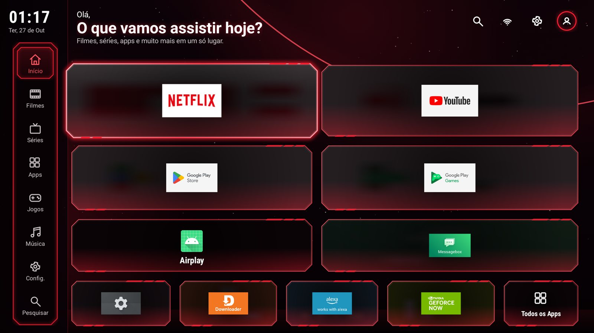 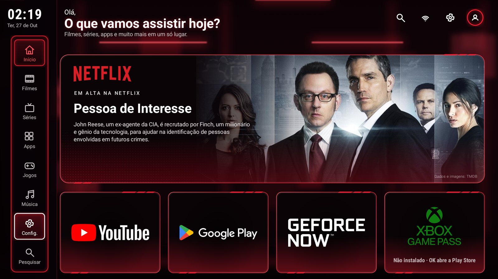</p>

### 2. Conteúdo de verdade · 1.0 a 1.3 · 27/10/2026
Dois destaques lado a lado (YouTube com login de TV e Netflix), vermelho vivo, o app virou a tela inicial da TV, Filmes e Séries só com o catálogo da Netflix e o card TV Aberta.

<p>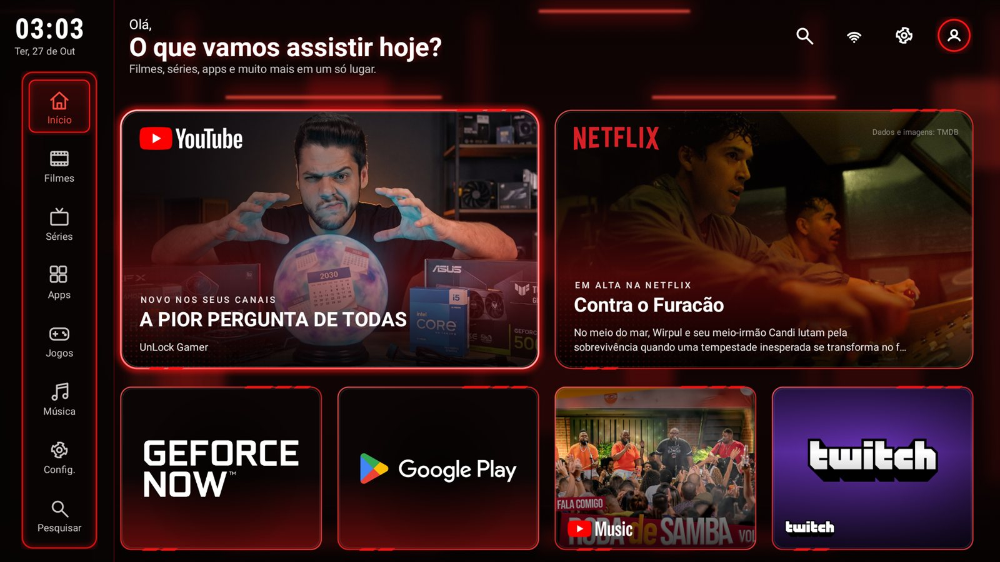</p>

### 3. Experiência · 1.4 · 27/10/2026
Menu dinâmico, apps abrindo na página inicial, monitor do sistema e recomendações pelo histórico de visualização da Netflix.

<p>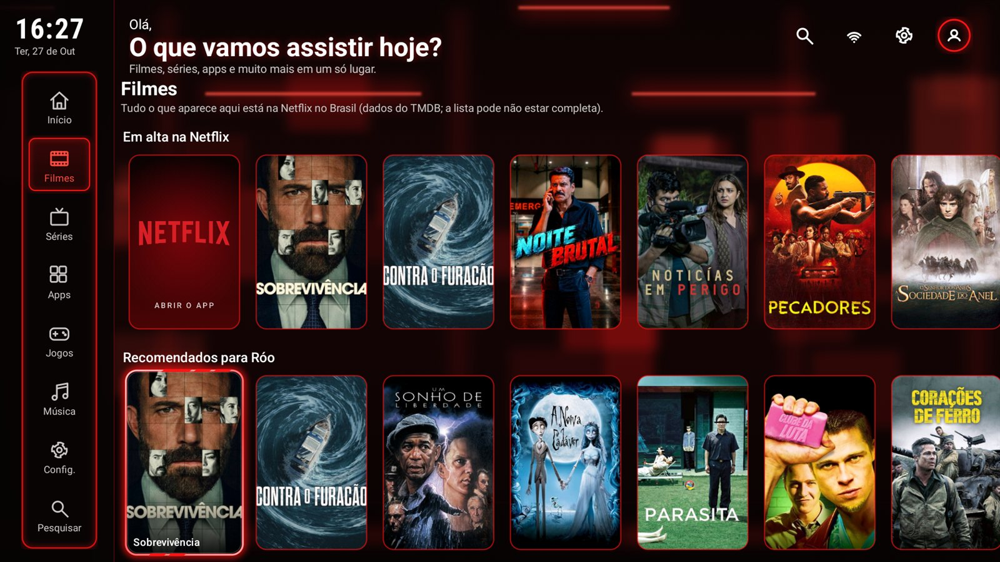 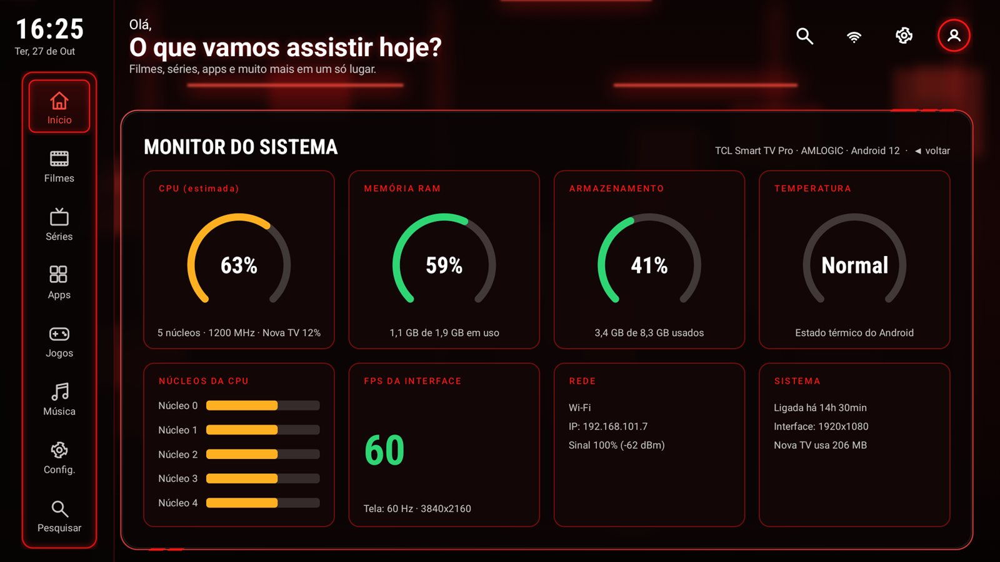</p>

### 4. Produção · 1.5 e 1.6 · 23/11/2026
App do Google publicado (o login do YouTube deixou de expirar a cada 7 dias), [site e política de privacidade](https://rodneigstv.github.io/nova-tv/) no GitHub Pages e o código de reconexão aparecendo sozinho no destaque.

<p>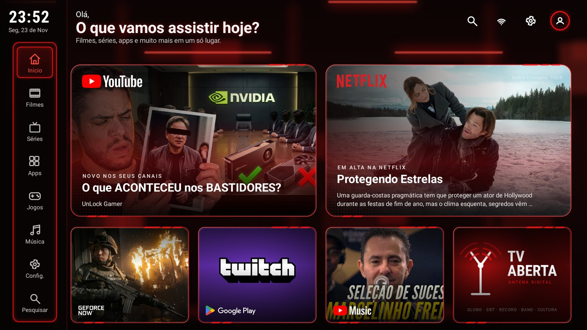</p>

### 5. Controle remoto · 1.7 · 24/11/2026
Os botões Netflix, YouTube, engrenagem e TV pararam quando a tela do Google TV foi desativada. Um serviço de acessibilidade passou a atendê-los em qualquer tela.

### 6. Redesenho e otimização · 1.8 a 1.9 · 24/11/2026
Tokens de design (texto, espaços, raios, foco e tempos), paleta de 3 neutros e 1 vermelho, área segura de 5%, foco claro, fim dos halos e das sombras, fundo pré-renderizado e correções de foco no menu. A CPU com o Início parado caiu 52%. Na 1.9 o projeto ganhou o nome **Lume TV**.

<p></p>

## Desafios resolvidos

| Problema | Causa | Solução |
|---|---|---|
| Botões do controle pararam de funcionar | Eram atendidos pela tela do Google TV, que foi desativada | `AccessibilityService` que atende os códigos da TCL (4062, 4065 e 4001) em qualquer tela |
| "Forçar parada" desligava os botões | Regra do Android: o serviço de acessibilidade de um app parado é desligado | Documentado e evitado nos testes (atualizar ou reinstalar não desliga) |
| Menu abria a página errada ao entrar pela lateral | O Android avisa "ganhou foco" ao item por onde o foco passou, mesmo depois de redirecioná-lo | A página só abre se o foco continuar no item |
| Conteúdo rolado aparecia por cima do cabeçalho | `ScrollView` com `clipChildren=false` desenha fora da própria área | Recorte com `clipBounds` |
| Quadros pesados no Início | Gradientes de tela cheia redesenhados a cada quadro | Imagem pré-renderizada em meia resolução, só deslocada |
| A Netflix não tem API de histórico | — | Histórico exportado pela própria Netflix, com o TMDB para achar títulos e gêneros |
| Apps abriam onde tinham parado | O Android retoma a última tela do app | Encerrar o app em segundo plano antes de abrir |
| Login do YouTube vencia a cada 7 dias | App do Google em modo de teste | App publicado, com site e política de privacidade |

## Arquitetura

Kotlin com as Views do Android desenhadas à mão no `Canvas`: sem XML de layout, sem AndroidX e sem Compose. São 20 arquivos e cerca de 4.000 linhas.

| Arquivo | Papel |
|---|---|
| `MainActivity.kt` | Telas, navegação pelo controle, cards, menu, páginas e login do YouTube |
| `Tema.kt` · `Cores.kt` | Tokens de design (texto, espaços, raios, foco e tempos) e paleta |
| `DestaqueView.kt` · `Carrossel.kt` | Destaques e a troca automática de títulos |
| `CartaoView.kt` · `PosterView.kt` · `Vidro.kt` | Cards, pôsteres e a moldura comum com o anel de foco |
| `MenuViews.kt` · `Icones.kt` | Menu lateral e ícones desenhados em código |
| `FundoView.kt` | Fundo com brilho pré-renderizado e movimento lento |
| `MonitorView.kt` | Monitor do sistema |
| `Videos.kt` | YouTube Data API v3 e login de TV (OAuth para dispositivos) |
| `Catalogo.kt` · `Historico.kt` | TMDB (em alta, seções e cache) e recomendações pelo histórico |
| `Apps.kt` · `Logos.kt` · `Jogos.kt` | Apps instalados, logos oficiais e imagens de jogos da Steam |
| `TeclasService.kt` | Serviço de acessibilidade dos botões do controle |
| `VitrineView.kt` | Vitrine automática (pronta, mas desligada) |

`index.html` e `privacidade.html` são o site que o Google exige para o login do YouTube, publicado pelo GitHub Pages.

## Privacidade

- Sem anúncios, sem rastreamento e sem servidor próprio. O app só fala com serviços oficiais: Google (login e YouTube Data API), TMDB e loja Steam.
- O acesso ao YouTube é só de leitura e fica guardado apenas na TV. Veja a [política de privacidade](https://rodneigstv.github.io/nova-tv/privacidade.html).
- Chaves e histórico pessoal ficam fora do Git (`segredos.properties` e `netflix_historico.csv`).

## Créditos e avisos

Este produto usa a API do TMDB, mas não é endossado nem certificado pelo TMDB. Logos do Wikimedia Commons (domínio público). YouTube, Netflix, Google Play, GeForce NOW, TCL e as demais marcas pertencem aos seus titulares; este é um projeto pessoal, sem vínculo com essas empresas.

## Licença

Código sob a [licença MIT](LICENSE). Logos, marcas e imagens de terceiros não fazem parte da licença.

## Autoria

Projeto de **Rodnei Gustavo Santos Assis** ([@rodneigstv](https://github.com/rodneigstv)). Desenvolvido com o **Claude Code**, da Anthropic, a partir das ideias, do visual e das decisões do Rodnei, com cada versão testada na TV.
